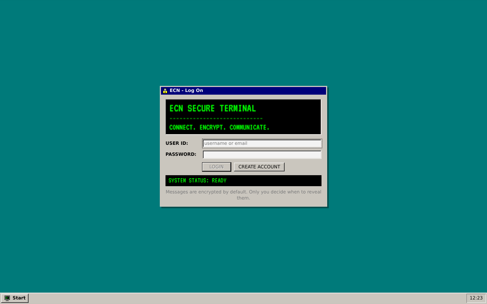
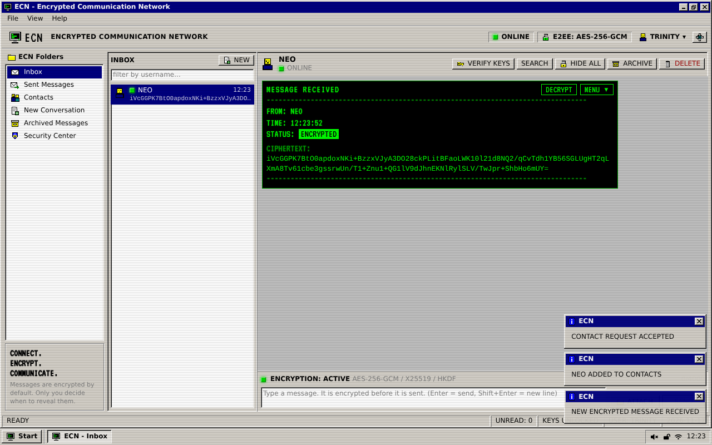
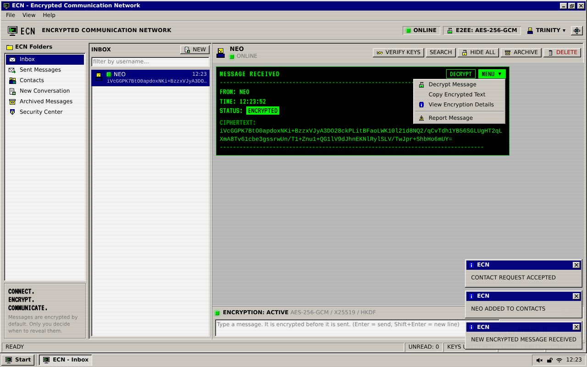
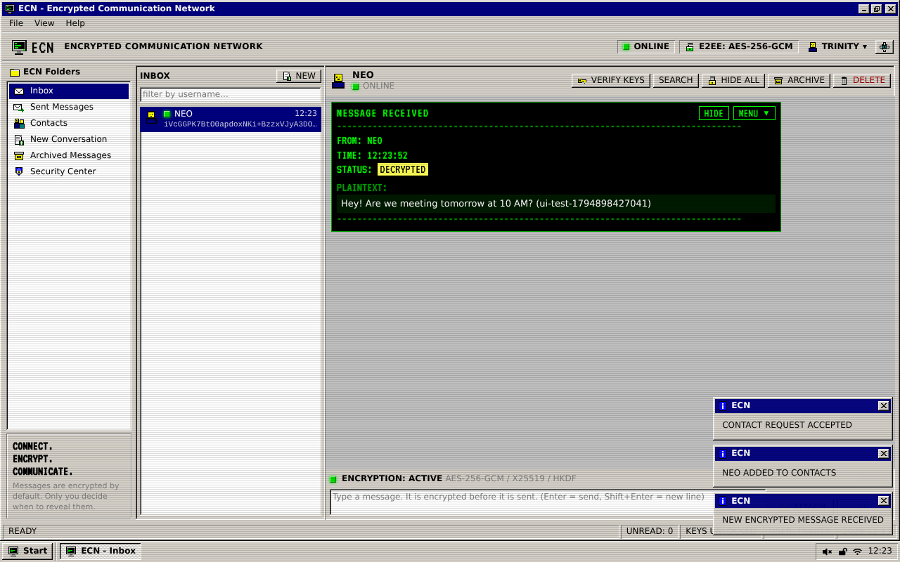
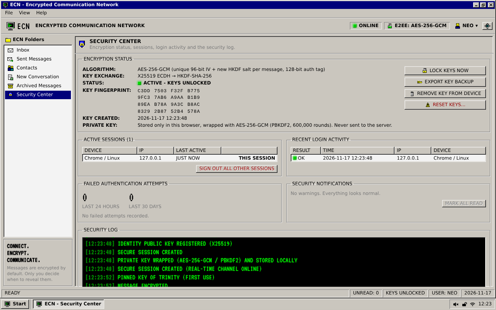
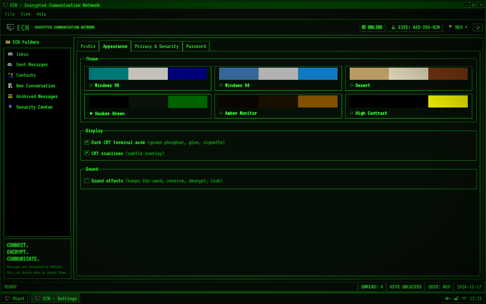
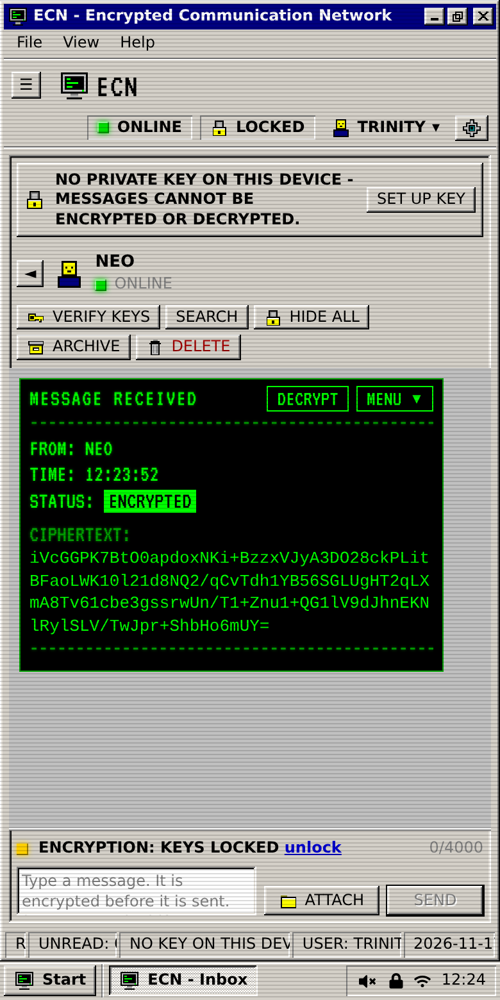

# ECN - Encrypted Communication Network

**CONNECT. ENCRYPT. COMMUNICATE.**
*Messages are encrypted by default. Only you decide when to reveal them.*

A full-stack, real-time, end-to-end encrypted messenger wrapped in a 1990s Windows 95/98 desktop: beveled buttons, title bars, a taskbar with a Start menu, VT323 terminal blocks and optional CRT scanlines.

| Login | Encrypted by default | Decrypt dropdown |
|---|---|---|
|  |  |  |

| Decrypted (and hideable) | Security Center | CRT mode | Mobile |
|---|---|---|---|
|  |  |  |  |

---

## 1. How the encryption works

Everything cryptographic happens in the browser with the **Web Crypto API** (no third-party crypto, no Base64 "encryption" - Base64 is only used to move binary data as text).

```
Registration   X25519 key pair generated in the browser.
               Public key  -> server.      Private key -> never leaves the browser.
               Private key is stored locally, wrapped with AES-256-GCM under a key derived from your
               password with PBKDF2-SHA-256 (600,000 rounds). Unlocked = non-extractable CryptoKey in memory.

Sending        shared  = X25519(myPrivate, peerPublic)
               msgKey  = HKDF-SHA-256(shared, salt = fresh random 16 bytes, info = "ECN1|key|sender|recipient|fingerprints")
               cipher  = AES-256-GCM(msgKey, iv = fresh random 12 bytes, plaintext, AAD = conversation|sender|recipient|fingerprints)
               -> POST { ciphertext(+16-byte tag), iv, salt, alg, senderFp, recipientFp }

Receiving      Same derivation (X25519 is symmetric), so the SENDER can also decrypt their own sent messages.
               Any change to ciphertext, tag, IV, salt, conversation, sender or key fingerprints makes GCM
               authentication fail -> "TAMPERED", and the message stays encrypted.
```

* Every message has its **own IV and its own HKDF salt**.
* The server stores **only** ciphertext + public parameters. There is no plaintext column; plaintext never appears in requests, the database or server logs (verified by the automated tests).
* **Decrypt Message** performs a real HKDF + AES-GCM decrypt. The terminal animation runs *after* the authenticated decrypt succeeds and only presents the real output. **Hide Plain Text** discards the plaintext from memory. Locking the keys (manually or after inactivity) re-hides everything.
* Optional "require my password for every decryption" re-authenticates by actually unwrapping the stored key.
* Peers' key fingerprints are pinned on first use (TOFU). If a contact's key changes, sending is blocked until you review it; a **safety number** lets you verify keys out-of-band.
* Message search is **local**: messages are decrypted in memory to build a throw-away index; results stay encrypted until you decrypt them.

### Honest limitations (please read)
* **No forward secrecy / key ratchet.** Identity keys are long-lived (static-static X25519 + per-message salt). If a private key *and* the stored ciphertext are both compromised, past messages can be read. A Signal-style double ratchet is the natural next step.
* **Metadata is visible to the server** (who talks to whom, when, message sizes).
* **First-contact trust:** a malicious server could substitute a public key the first time two users talk. TOFU pinning + safety-number verification mitigate this, but only if you verify.
* **Browser key storage:** the wrapped private key lives in `localStorage`. A cross-site-scripting bug would be serious; the app ships a strict CSP (no inline scripts) and imports the unlocked key as non-extractable, but no web app can match a native app's key isolation.
* **Resetting your keys makes old messages unreadable** (for you and for the other side, because fingerprints are bound into the encryption). Use *Export Key Backup* in the Security Center.
* **Reports contain no message text** - the server cannot read it. Only the message ID and reason are stored.
* Presence/typing are in memory: run **one server instance** (or add the Socket.IO Redis adapter to scale).

---

## 2. Features

All of section 1-14 of the brief is implemented and exercised by tests:

* Retro UI: Win95/98 window chrome (working minimize/maximize/close), taskbar + Start menu, menu bar, pixel icons, classic scrollbars, loading bars, 6 themes (Windows 95, Windows 98, Desert, Hacker Green, Amber, High Contrast), **Dark CRT terminal mode**, scanlines toggle, BIOS boot screen with real Web Crypto capability checks.
* Auth: register / login / logout, scrypt password hashing, HttpOnly + Secure + SameSite cookie sessions (hashed tokens in DB, sliding expiry), brute-force lockout, CSRF header + Origin checks, rate limits, Helmet/CSP/HSTS, zod validation, profile + settings, password change (also re-wraps the local key).
* Messaging: Inbox / Sent / Archived, unread counts, encryption preview before sending, encrypted file attachments (<=700 KB), typing indicators, delivery status (sent / delivered / read), timestamps, local search, per-user delete & archive.
* Contacts: search by username, send / accept / reject / cancel requests, remove, online/offline presence, start conversations.
* Security Center: algorithm + status, key fingerprint, active sessions (revoke), login history, failed attempts, notifications, live terminal log, key backup/restore, key reset.
* Responsive layout, keyboard-accessible menus and dialogs, reduced-motion support, sound-effects toggle (Web Audio, no files).

---

## 3. Project structure

```
client/                 React + Vite + Tailwind + Framer Motion + React Icons + Web Crypto
  src/components/       Navbar, Sidebar, ChatWindow, MessageBubble, MessageDropdown, DecryptionAnimation,
                        TerminalWindow, EncryptionPreview (in MessageDialogs), SecurityDashboard, Desktop (taskbar) ...
  src/pages/            Login, Register, Dashboard, Chat (Inbox/Archived), Sent, Contacts, NewConversation,
                        SecurityCenter, Settings
  src/services/         crypto.js (primitives), encryption.js (message protocol), keyManager.js (keys at rest),
                        api.js, socket.js, sound.js
  src/styles/           retro.css (design system + themes), terminal.css
  tests/crypto.test.mjs 14 cryptography tests
  vercel.json           Vercel config (rewrites + security headers)
server/                 Node + Express + Socket.IO + Mongoose (MongoDB Atlas)
  controllers/ models/ routes/ middleware/ sockets/ services/ config/ server.js
  tests/e2e.test.mjs    12 end-to-end tests (real server, real DB, real sockets, real client crypto)
render.yaml             one-click backend blueprint for Render
```

---

## 4. Run it locally

**Requirements:** Node 20+ and a MongoDB database (free [MongoDB Atlas](https://www.mongodb.com/atlas) M0 cluster). Browser: **Chrome/Edge 133+, Firefox 130+, Safari 17+** (X25519 in Web Crypto), over HTTPS or `localhost`.

```bash
# 1. install
npm run install:all

# 2. configure the server
cp server/.env.example server/.env
#   - MONGODB_URI   : Atlas -> Connect -> Drivers  (Atlas: Network Access must allow your IP / 0.0.0.0/0)
#   - SESSION_SECRET: node -e "console.log(require('crypto').randomBytes(48).toString('base64url'))"
#   - CLIENT_ORIGIN : http://localhost:5173

# 3. two terminals
npm run dev:server      # API + Socket.IO on :5000
npm run dev:client      # Vite on :5173 (proxies /api and /socket.io to :5000)
```

Open <http://localhost:5173>, create two accounts (use a normal and a private window), add each other as contacts, and chat.

**Single-process mode:** `npm run build && npm start` - the Express server serves `client/dist` on `:5000`.

### Tests
```bash
npm run test:crypto                                   # 14 cryptography tests, no database needed
MONGODB_URI=mongodb://localhost:27017/ecn_test npm --prefix server test   # 12 end-to-end tests (use a throw-away DB!)
```
The e2e test drops its own temporary database when it finishes. Never point it at production.

---

## 5. Deploy

> Vercel hosts static sites and serverless functions - it **cannot run a persistent Socket.IO/WebSocket server**. So: **frontend on Vercel, backend on a Node host** (Render, Railway, Fly.io, a VPS...). MongoDB stays on Atlas.

### A. Backend (Render example)
1. Push this repo to GitHub.
2. Render -> **New -> Blueprint** -> select the repo (uses `render.yaml`), or create a Web Service with *Root Directory* `server`, build `npm install`, start `npm start`.
3. Set environment variables (see table below). Required: `MONGODB_URI`, `CLIENT_ORIGIN` (your Vercel URL), `NODE_ENV=production`, `SESSION_SECRET`.
4. Note the backend URL, e.g. `https://ecn-server.onrender.com`. Check `https://.../api/health`.

### B. Frontend (Vercel)
1. Vercel -> **Add New Project** -> import the repo -> **Root Directory: `client`** (framework: Vite).
2. Edit `client/vercel.json`: replace **every** `YOUR-BACKEND-HOST` with your backend host (e.g. `ecn-server.onrender.com`). This (a) proxies `/api` through Vercel so the session cookie is first-party and (b) allows the WebSocket in the CSP.
3. Add the Vercel environment variable `VITE_SOCKET_URL=https://ecn-server.onrender.com` (WebSockets go straight to the backend, authenticated by a short-lived signed ticket, not by cookie).
4. Deploy, then put the final Vercel URL into the backend's `CLIENT_ORIGIN` and redeploy the backend.

> With the Vercel rewrite in front of Render set `TRUST_PROXY=2` (two proxy hops) so rate limits and the login history see the real client IP. If browsers call the backend directly, use `1`.

*Alternative without the rewrite:* set `VITE_API_URL=https://ecn-server.onrender.com` on Vercel and `CROSS_SITE=true` on the server. This works, but browsers that block third-party cookies (Safari, Firefox strict mode) will break login - the rewrite is strongly recommended.

### C. One service for everything
Build the client and let Express serve it (`SERVE_CLIENT=true`, default): on Render/Railway use build `npm run install:all && npm run build`, start `npm start`. Same-origin, no CORS or cookie caveats, GitHub Pages is not suitable (needs the API).

### HTTPS
Cookies are `Secure` and use the `__Host-` prefix in production; HSTS is on; `FORCE_HTTPS=true` redirects plain HTTP when behind a proxy that sets `X-Forwarded-Proto` (Render, Railway, Fly, Vercel all do). For a VPS without a proxy you can terminate TLS in Node: set `TLS_KEY_PATH` and `TLS_CERT_PATH`.

### Server environment variables
| Variable | Required | Purpose |
|---|---|---|
| `MONGODB_URI` | yes | MongoDB Atlas connection string |
| `SESSION_SECRET` | yes (prod) | >= 32 random chars; signs socket tickets |
| `CLIENT_ORIGIN` | yes | Comma-separated allowed browser origins (no trailing slash) |
| `NODE_ENV` | yes (prod) | `production` enables Secure cookies, HSTS |
| `PORT` | no | default 5000 |
| `TRUST_PROXY` | no | proxy hops in front of the server (default 1) |
| `FORCE_HTTPS` | no | redirect HTTP to HTTPS |
| `CROSS_SITE` | no | SameSite=None cookies (only for direct cross-site API calls) |
| `SERVE_CLIENT` | no | serve `client/dist` (default true) |
| `TLS_KEY_PATH`, `TLS_CERT_PATH` | no | native HTTPS |

Client (build-time): `VITE_SOCKET_URL`, `VITE_API_URL` (see `client/.env.example`).

---

## 6. Troubleshooting
* **"BROWSER LACKS X25519 SUPPORT"** - update the browser (see versions above) and use HTTPS/localhost.
* **Login works but "OFFLINE"** - the socket cannot reach the backend: check `VITE_SOCKET_URL`, the CSP `connect-src` in `vercel.json`, and `CLIENT_ORIGIN`.
* **"ORIGIN NOT ALLOWED" / "CSRF CHECK FAILED"** - `CLIENT_ORIGIN` must exactly equal the browser origin (scheme + host, no trailing slash).
* **Atlas connection timeout** - add your host's IP (or `0.0.0.0/0`) under Atlas -> Network Access.
* **New device cannot read old messages** - import the key backup from the Security Center on the old device; otherwise generate new keys (old messages stay unreadable).
* Render free instances sleep; the first request after idle takes ~30 s.
